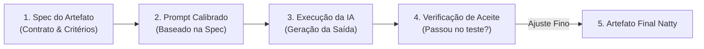

# Repositório preparado para assitência por IA

Sobre a adoção do **`AGENTS.md`** e o **Spec-Driven Development (SDD)** neste repositório: **Não apenas é relevante, como é o maior sinal de maturidade que você pode colocar neste repositório.**

A maioria dos desenvolvedores que entram em IA cai no que o mercado chama de **"Vibe Coding"** ou **"Vibe Prompting"**: abrem o chat, digitam um prompt genérico e torcem para o resultado ser bom. Quando o resultado vem genérico, artificial ou alucinado ("Fake Natty"), culpam a ferramenta.

Trazer o **`AGENTS.md`** e o **Spec-Driven Development (SDD)** para um repositório de IA — mesmo sem backend tradicional ou banco de dados — posiciona você imediatamente como uma **Engenheira de Sistemas de IA**, que governa agentes com método, determinismo e contratos claros.

Veja em detalhes como e por que aplicar os dois:

---

## 1. Por que o `AGENTS.md` é ainda mais crítico aqui?

Em um repositório tradicional (ex.: Spring Boot, React), os agentes conseguem deduzir muita coisa lendo o `package.json`, `pom.xml` ou a arquitetura de pastas.

Neste repositório, por se tratar de um projeto de **experimentação, curadoria multimodal e engenharia de prompts**, o agente não tem um framework para se apoiar. Se ele não for guiado, vai:

- Criar arquivos em pastas aleatórias.
- Gerar textos com clichês sintéticos (*"No mundo acelerado de hoje..."*).
- Esquecer de registrar os metadados dos experimentos.
- Fazer commits fora do padrão.

### O papel do `AGENTS.md`:

O `AGENTS.md` funciona como o **System Prompt do Repositório** (reconhecido por ferramentas modernas como Antigravity, Cursor, Copilot Workspace, Claude Code). Ele define as regras de engajamento entre você e qualquer agente:

```markdown
# AGENTS.md (Exemplo Prático)

## Contexto & Papel
- **Autora:** Engenheira de software sênior em transição para desenvolvimento assistido por IA.
- **Papel do Agente:** Par de programação técnico (Pair Programmer) e co-piloto crítico. Não aja como assistente subserviente; valide decisões, aponte riscos e sugira melhorias técnicas.

## Princípios de Qualidade ("Natty or Not")
- **Zero Fluff / Anti-Clichês:** Banidos termos ocos como "na era digital", "tapeçaria de soluções", "revolucionário", "mergulhar de cabeça".
- **Foco Técnico:** Priorize analogias de arquitetura de software, débitos técnicos, tipagem, testes e boas práticas.
- **Human-in-the-Loop:** Toda saída gerada deve prever espaço para crítica, validação e ajuste manual.

## Governança do Repositório
- **Prompts:** Devem seguir o modelo unificado de `prompts/README.md`.
- **Rascunhos:** Ideias locais ficam em `rascunhos-locais/` (ignorado no git).
- **Git Commits:** Padrão Conventional Commits em português (`docs:`, `feat:`, `chore:`).
```

---

## 2. O que é Spec-Driven Development (SDD) no contexto de IA?

Em engenharia clássica, SDD significa escrever o contrato da API (OpenAPI/Swagger) ou a especificação formal antes de escrever o código.

No desenvolvimento assistido por IA, **Spec-Driven Development significa escrever a Especificação de Requisitos e Critérios de Aceite do Artefato ANTES de executar o prompt gerador.**

### O ciclo SDD com IA:



### Exemplo de uma Spec antes de gerar um capítulo do E-book:

Em vez de promptar: *"Escreva o capítulo 1 sobre IA e débitos técnicos"*, você cria uma spec:

```markdown
### SPEC-001: Capítulo 1 - A Ilusão da Produtividade Sintética
- **Objetivo:** Explicar como código gerado sem supervisão acumula débito técnico invisível.
- **Público:** Engenheiros de software plenos e sêniores.
- **Tamanho:** Entre 800 e 1200 palavras.
- **Tópicos Obrigatórios:**
  - Dependências zumbis / alucinação de pacotes.
  - Degradação de manutenibilidade (código difícil de ler por humanos).
  - Estudo de caso: O bug que parecia correto no PR.
- **Critérios de Aceite (Definition of Done):**
  - [ ] Contém pelo menos 1 exemplo prático de código (Antes vs Depois).
  - [ ] Não contém adjetivos inflacionados ou introduções genéricas.
  - [ ] Conclui com um checklist de validação em code review.
```

Com essa Spec escrita, o agente tem **fronteiras determinísticas** para criar o conteúdo, e você tem uma **régua objetiva de testes** para avaliar se a resposta foi aceita ou rejeitada.

---

## 3. O Impacto disso no seu Portfólio

Para quem avaliar o seu GitHub:

| Repositório Comum de IA | Seu Repositório com `AGENTS.md` + SDD |
| :--- | :--- |
| Textos cheios de clichês gerados pelo ChatGPT. | Textos densos, técnicos e com identidade autoral. |
| Prompts soltos sem histórico ou critério. | Rastreabilidade completa com `prompts/` e `Definition of Done`. |
| Sensação de "qualquer um faz isso". | Sensação de **"ela sabe governar e liderar sistemas de IA"**. |
| Foco na ferramenta. | Foco na **metodologia e arquitetura**. |

---
