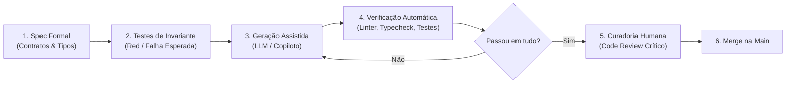

# Capítulo 3: Engenharia de Software Natty (Boas Práticas e Padrões)

A engenharia de software tradicional sempre foi orientada pelo controle de complexidade e previsibilidade. Modelos de IA generativa, por sua natureza probabilística, introduzem uma variável de não-determinismo no ciclo de vida de desenvolvimento. A **Engenharia de Software Natty** não busca eliminar a IA, mas sim criar barreiras arquiteturais e contratos formais que canalizem o poder gerador dos LLMs para saídas determinísticas, auditáveis e resilientes.

Para que o desenvolvimento assistido atinja nível de produção, substituímos o improviso ("vibe prompting") por quatro pilares metodológicos: **Spec-Driven Prompting**, **Test-Driven Prompting**, **Modularização Estrita** e **Governança de Contexto**.

---

## 1. O Pipeline de Entrega Natty

A figura abaixo ilustra a esteira técnica recomendada para tarefas assistidas por IA. Observe que o modelo de linguagem atua exclusivamente na etapa de síntese, enquadrado por contratos anteriores e validações posteriores:



---

## 2. Spec-Driven Prompting: Contratos Antes da Sintaxe

O maior erro ao solicitar código a uma IA é descrever intenções em linguagem natural vaga. Linguagem natural é inerentemente ambígua; contratos de código não são.

No *Spec-Driven Prompting*, o engenheiro define os esquemas de dados, interfaces e invariantes com tipagem estrita antes de solicitar qualquer lógica de processamento. Ao receber a interface pronta, o espaço de busca estatístico do modelo é reduzido drasticamente.

> [!TIP]
> **Defina Schemas Rígidos:** Utilize ferramentas como Zod (TypeScript), Pydantic (Python) ou JSON Schema para definir as fronteiras de entrada e saída. Solicite que a IA implemente apenas a transformação de dados que conecta a entrada `A` validada à saída `B` esperada.

### Estudo de Caso Prático: Contrato com Zod e Função Pura

Em vez de promptar: *"Crie uma função que calcula desconto de cliente vip"*, forneça o contrato inviolável:

```typescript
import { z } from 'zod';

// 1. Definição estrita do contrato de entrada
export const OrderInputSchema = z.object({
  customerId: z.string().uuid(),
  loyaltyTier: z.enum(['STANDARD', 'SILVER', 'GOLD', 'PLATINUM']),
  cartTotalInCents: z.number().int().positive(),
  appliedCoupon: z.string().regex(/^[A-Z0-9_-]{4,16}$/).optional(),
});

export type OrderInput = z.infer<typeof OrderInputSchema>;

// 2. Definição estrita do contrato de saída
export const DiscountResultSchema = z.object({
  discountInCents: z.number().int().nonnegative(),
  finalAmountInCents: z.number().int().positive(),
  appliedRule: z.string().min(1),
});

export type DiscountResult = z.infer<typeof DiscountResultSchema>;

// 3. Implementação pura sintetizada pelo assistente sob restrição contratual
export function calculateOrderDiscount(input: OrderInput): DiscountResult {
  // A validação do schema no ponto de entrada garante que nenhum dado sujo entre na regra
  const validated = OrderInputSchema.parse(input);

  const discountRateMap: Record<OrderInput['loyaltyTier'], number> = {
    STANDARD: 0,
    SILVER: 0.05,
    GOLD: 0.10,
    PLATINUM: 0.20,
  };

  const baseRate = discountRateMap[validated.loyaltyTier];
  const couponBonusInCents = validated.appliedCoupon === 'BEMVINDO20' ? 2000 : 0;

  const percentageDiscountInCents = Math.floor(validated.cartTotalInCents * baseRate);
  const rawDiscount = percentageDiscountInCents + couponBonusInCents;

  // Invariante de negócio: o desconto nunca pode exceder o valor do carrinho
  const discountInCents = Math.min(rawDiscount, validated.cartTotalInCents - 1);
  const finalAmountInCents = validated.cartTotalInCents - discountInCents;

  return DiscountResultSchema.parse({
    discountInCents,
    finalAmountInCents,
    appliedRule: `TIER_${validated.loyaltyTier}_PLUS_COUPON`,
  });
}
```

---

## 3. Test-Driven Prompting (TDP)

O *Test-Driven Prompting* é a adaptação moderna do TDD (Test-Driven Development) para a era dos agentes. O fluxo inverte o papel convencional do copiloto:

1. O engenheiro humano (ou o agente sob sua supervisão) escreve a **suíte de testes unitários baseada na especificação**.
2. Os testes devem cobrir obrigatoriamente: o caminho feliz, casos de borda (*boundary values*), concorrência e lançamentos de erro controlados.
3. O prompt fornecido ao agente de código contém **apenas a interface e o arquivo de teste quebrado**.
4. A instrução para o modelo é cirúrgica: *"Escreva o código mínimo necessário para fazer estes testes passarem sem alterar a suíte de testes."*

Essa técnica elimina a ilusão do autoteste tautológico (visto no Capítulo 1), pois a régua de aceitação já foi fixada antes da geração da lógica.

---

## 4. Redução do Espaço de Hipóteses (Modularização Estrita)

Modelos generativos deterioram rapidamente sua qualidade quando operam em métodos longos com múltiplos efeitos colaterais (acesso a rede, escrita em disco, mutação de variáveis globais).

Para maximizar a precisão da IA, aplique os princípios clássicos de arquitetura:
- **Arquitetura Hexagonal (Ports & Adapters):** Isole as regras de negócio puras (núcleo de domínio) da infraestrutura (frameworks, bancos de dados, APIs externas). LLMs geram lógica de domínio com quase 100% de acerto quando desacopladas de drivers e ORMs.
- **Funções Puras:** Sempre que possível, estruture o código como funções que recebem dados imutáveis e retornam dados novos sem mutar o estado externo.
- **Princípio da Responsabilidade Única (SRP):** Classes ou módulos com escopo minúsculo cabem inteiros dentro da janela de atenção do LLM, eliminando perda de contexto.

---

## 5. Governança de Contexto Operacional

Agentes e copilotos não devem adivinhar as convenções da equipe. A arquitetura moderna de repositórios exige arquivos de governança dedicados:

- **`AGENTS.md`:** Instruções operacionais globais, limites de autonomia, regras de revisão de documentação e critérios de aprovação prévia.
- **System Prompts de Repositório / `.cursorrules`:** Convenções de estilo, linters preferidos, bibliotecas autorizadas e padrões proibidos (ex.: proibir o uso de bibliotecas de manipulação de data legadas como `moment.js` e forçar `date-fns` ou APIs nativas `Temporal`).

> [!NOTE]
> Governança de contexto transforma o assistente de IA em um membro de equipe devidamente ambientado com os padrões de engenharia do repositório desde o primeiro minuto de execução.

No **Capítulo 4**, consolidaremos essa jornada analisando a evolução da carreira: **O Desenvolvedor Centauro e o Futuro da Engenharia**, acompanhado de um prático *Checklist de Code Review para Pull Requests Gerados por IA*.

