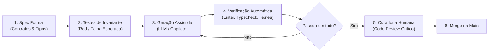

# Engenharia de Software Natty: Boas Práticas, Limites e Antipatterns com IA

**Subtítulo:** *Guia de sobrevivência para manter bases de código limpas, seguras e humanas em tempos de copilotos autônomos.*  
**Autora:** Heviane  
**Laboratório:** [Natty or Not Lab](https://github.com/heviane-learning/natty-or-not-lab) — Projeto `01-eng-software-natty`  
**Versão:** 1.0.0 (Outubro / 2026)  
**Metodologia:** Spec-Driven Development ([SPEC-001](file:///e:/Projects/GitHub/heviane-learning/natty-or-not-lab/projetos/01-eng-software-natty/specs/SPEC-001-ebook.md))

---

## 📑 Sumário

1. [Capítulo 1: O Efeito "Fake Natty" no Código](#capítulo-1-o-efeito-fake-natty-no-código)
   - A Ilusão da Produtividade Sintética
   - A Assimetria Cognitiva no Code Review
   - Estudo de Caso: O Teste Tautológico (Falso Positivo)
   - Lições de Engenharia
2. [Capítulo 2: Antipatterns no Desenvolvimento Assistido por IA](#capítulo-2-antipatterns-no-desenvolvimento-assistido-por-ia)
   - Dependency Hallucination (Alucinação de Pacotes e Slopsquatting)
   - Blind Acceptance ("Síndrome do Tab-Tab-Tab")
   - Context Starvation (Inanição de Contexto)
   - Boilerplate Inflation (Imperativo vs. Declarativo)
   - Matriz Comparativa de Antipatterns
3. [Capítulo 3: Engenharia de Software Natty (Boas Práticas e Padrões)](#capítulo-3-engenharia-de-software-natty-boas-práticas-e-padrões)
   - O Pipeline de Entrega Natty
   - Spec-Driven Prompting: Contratos Antes da Sintaxe (TypeScript + Zod)
   - Test-Driven Prompting (TDP)
   - Redução do Espaço de Hipóteses (Modularização e Arquitetura Hexagonal)
   - Governança de Contexto Operacional (`AGENTS.md`)
4. [Capítulo 4: O Desenvolvedor Centauro e o Futuro da Engenharia](#capítulo-4-o-desenvolvedor-centauro-e-o-futuro-da-engenharia)
   - Da Digitação de Sintaxe à Orquestração de Agentes
   - As Habilidades que Ganham Prêmio no Mercado
   - O Princípio da Soberania Técnica (Human-in-the-Loop)
   - Checklist Acionável de Code Review para PRs com IA
   - Conclusão

---

# Capítulo 1: O Efeito "Fake Natty" no Código

A métrica mais perigosa na engenharia de software moderna é a velocidade bruta de digitação. Um modelo de linguagem avançado consegue gerar 300 linhas de código sintaticamente impecáveis, documentadas com JSDoc e formatadas com Prettier em menos de 10 segundos. No entanto, em sistemas distribuídos e de missão crítica, a digitação de sintaxe nunca foi o gargalo da entrega. O verdadeiro custo de engenharia reside na **modelagem mental**, na **prevenção de falhas ocultas** e na **manutenibilidade a longo prazo**.

Quando copilotos e assistentes autônomos são utilizados sem supervisão rigorosa, surge o que chamamos de **Código "Fake Natty"**: uma implementação que tem aparência estética profissional, nomes de variáveis expressivos e tipagem aparentemente robusta, mas que, sob estresse de produção, desmorona devido a premissas lógicas frágeis, ausência de idempotência ou falsos positivos em suítes de testes.

## 1. A Ilusão da Produtividade Sintética

A produtividade assistida por IA frequentemente opera sob uma miragem de aceleração. Durante a fase inicial de desenvolvimento (*greenfield*), gerar código a partir do zero produz uma sensação imediata de fluxo. Funcionalidades inteiras parecem nascer prontas em minutos.

O débito técnico gerado por IA, contudo, é assíncrono. Diferente do desenvolvedor júnior que comete erros visíveis de sintaxe ou estrutura, o modelo generativo gera código com **alta fluência formal e baixa densidade semântica**. Ele reproduz padrões estatísticos comuns encontrados na internet aberta, ignorando as particularidades do domínio de negócio, regras de concorrência ou o ciclo de vida dos recursos da aplicação.

> [!WARNING]
> **A Armadilha do Débito Sintético:** Código gerado por IA tende a inflar a base com abstrações prematuras e tratamentos de exceção genéricos (`try/catch` vazios ou re-lançamentos sem contexto). Essa proliferação superficial mascara lacunas arquiteturais que só se manifestam sob carga ou em falhas de rede parciais.

## 2. A Assimetria Cognitiva no Code Review

Na engenharia tradicional, o processo de revisão de código (*code review*) baseia-se na leitura crítica de uma solução construída por outro ser humano que pensou sobre o problema. Existe uma linha de raciocínio contextual que orienta as decisões.

Ao revisar código gerado por IA, o revisor humano enfrenta uma severa **assimetria cognitiva**:

1. **Viés da Autoridade Estética:** O código parece correto à primeira vista. A identação é perfeita, o padrão de nomenclatura segue convenções idiomáticas e o código compila sem avisos do linter.
2. **Esforço Desproporcional de Depuração:** Ler e identificar uma falha sutil de lógica em um código que "parece pronto" consome significativamente mais energia mental do que escrever a lógica do zero com intenção clara.
3. **Fadiga de Contexto:** Como o volume de linhas submetidas em cada Pull Request aumenta drasticamente, os revisores tendem a relaxar o escrutínio sobre casos de borda (*edge cases*), confiando no visual limpo do código.

## 3. Estudo de Caso: O Teste Tautológico (Falso Positivo)

O sintoma mais comum do efeito *Fake Natty* ocorre na geração automatizada de testes unitários. Modelos de IA são excelentes em maximizar métricas quantitativas de cobertura de código (*code coverage*), mas frequentemente falham em validar invariantes de negócio.

Considere o cenário de processamento de pagamento idempotente. Abaixo, comparamos a abordagem gerada roboticamente versus a abordagem com rigor de engenharia:

### ❌ Versão Fake Natty: Teste Tautológico

Neste exemplo gerado sem calibragem, a IA gera um teste que atinge 100% de cobertura de linhas, mas é conceitualmente inútil:

```typescript
describe('PaymentService (Fake Natty)', () => {
  it('deve processar o pagamento com sucesso', async () => {
    // A IA cria mocks circulares onde o próprio mock valida o resultado
    const mockRepo = { findByIdempotencyKey: jest.fn().mockResolvedValue(null), save: jest.fn() };
    const mockGateway = { charge: jest.fn().mockResolvedValue({ status: 'PAID', txId: '123' }) };
    
    const service = new PaymentService(mockRepo, mockGateway);
    const result = await service.processPayment({ key: 'order-1', amount: 100 });

    // Assertivas tautológicas: apenas conferem se os mocks chamaram a si mesmos
    expect(mockGateway.charge).toHaveBeenCalledTimes(1);
    expect(result.status).toBe('PAID');
    // SE alguém remover a verificação de duplicidade no service, este teste AINDA PASSA!
  });
});
```

### ✅ Versão Natty: Validação de Invariante e Idempotência Real

A abordagem de engenharia madura foca no comportamento do sistema sob condições concorrentes e falhas de negócio:

```typescript
describe('PaymentService (Natty Real)', () => {
  it('deve garantir idempotência estrita rejeitando transações duplicadas em voo', async () => {
    const existingTransaction = { id: 'tx-existing', key: 'order-1', status: 'PROCESSING' };
    const mockRepo = {
      findByIdempotencyKey: jest.fn().mockResolvedValue(existingTransaction),
      save: jest.fn(),
    };
    const mockGateway = { charge: jest.fn() };

    const service = new PaymentService(mockRepo, mockGateway);

    // O teste valida o invariante: NUNCA acionar o gateway se a transação já existir
    await expect(service.processPayment({ key: 'order-1', amount: 100 }))
      .rejects
      .toThrow(ConflictException);

    // Assertiva defensiva crítica: o dinheiro do cliente não foi cobrado duas vezes
    expect(mockGateway.charge).not.toHaveBeenCalled();
    expect(mockRepo.save).not.toHaveBeenCalled();
  });
});
```

> [!NOTE]
> No teste *Fake Natty*, o modelo satisfez a métrica superficial de cobertura, mas ignorou o risco financeiro da operação. No teste *Natty*, a engenheira impôs a validação da integridade transacional.

## 4. Lição de Engenharia: Como Manter o Código Autêntico

- **Não terceirize o design de contratos:** A definição de interfaces, esquemas de validação e tipos primitivos deve ser concebida pelo arquiteto humano antes da solicitação de implementações.
- **Auditoria de asserções negativas:** Ao receber testes gerados por IA, force o código de produção a quebrar intencionalmente (*mutation testing* manual) para verificar se o teste realmente acusa a falha.
- **A regra da legibilidade humana:** Se você não consegue explicar linha por linha como aquele trecho gerado funciona em uma sessão de pair programming, esse código não está pronto para a branch `main`.

---

# Capítulo 2: Antipatterns no Desenvolvimento Assistido por IA

Assistentes de código baseados em Modelos de Linguagem de Grande Porte (LLMs) operam calculando probabilidades estatísticas de tokens subsequentes. Eles não possuem um compilador interno, não realizam resolução de dependências em tempo real e não compreendem o ciclo de vida da infraestrutura onde o código será executado.

Quando a equipe de engenharia adota copilotos sem governança e sem diretrizes claras de revisão, padrões arquiteturais degenerativos começam a se infiltrar silenciosamente nos repositórios. A seguir, dissecamos os quatro antipatterns mais críticos identificados em bases de código assistidas por IA, seus impactos operacionais e como neutralizá-los.

## 1. Dependency Hallucination (Alucinação de Pacotes)

A alucinação de dependências ocorre quando o modelo sugere a importação de uma biblioteca que não existe, mas cujo nome parece perfeitamente razoável e idiomático para a tarefa solicitada (ex.: `express-jwt-permissions-guard` ou `py-crypto-vault-validator`).

O perigo imediato não é apenas a falha de build (`ModuleNotFoundError`), mas sim a vulnerabilidade de segurança conhecida como **Slopsquatting** (ou *AI Package Typosquatting*):

> [!CAUTION]
> **Ataque à Cadeia de Suprimentos via IA:** Atacantes monitoram alucinações recorrentes de LLMs e registram intencionalmente esses nomes de pacotes fantasmas nos repositórios públicos (npm, PyPI, Maven Central). Se um desenvolvedor aceita a sugestão da IA e roda `npm install` sem verificar a autenticidade do pacote, instala código malicioso diretamente na esteira de integração contínua (CI/CD) da organização.

## 2. Blind Acceptance ("Síndrome do Tab-Tab-Tab")

A facilidade dos atalhos de autocompletion cria um hábito perigoso: o desenvolvedor aperta `Tab` sucessivamente para blocos inteiros de código sem realizar a leitura analítica linha por linha.

### Sintomas em Produção:
- **Vazamento de Recursos:** Código gerado frequentemente instancia conexões com bancos de dados, buffers ou streams sem fechá-los em cláusulas seguras (`try/finally`, context managers `with` ou blocos `using`).
- **Explosão de Complexidade Ciclomática:** O modelo tende a resolver problemas de fluxo encadeando múltiplos blocos `if/else` aninhados e `switch/case` redundantes, em vez de aplicar polimorfismo ou estratégias de design patterns.
- **Tratamento Genérico de Falhas:** Capturas cegas do tipo `catch (Exception e) { return null; }` que silenciam erros críticos e tornam a rastreabilidade via logs impossível em ambiente de produção.

## 3. Context Starvation (Inanição de Contexto)

Ocorre quando o desenvolvedor fornece ao copiloto apenas o trecho isolado onde está trabalhando, esperando que ele deduza regras arquiteturais globais, padrões de concorrência e modelos de domínio da empresa.

Modelos de IA sofrem do viés de localidade: sem a visão do sistema, eles resolvem o problema imediato violando as fronteiras arquiteturais do projeto. O resultado é a criação de acoplamentos indevidos (ex.: camadas de controle acessando bancos diretamente sem passar pelos repositórios de domínio).

## 4. Boilerplate Inflation

Como a IA não "sente dor" ao digitar, ela tende a gerar dezenas de linhas de lógica imperativa verbosa para tarefas que bibliotecas padrão ou funções de ordem superior resolveriam de forma declarativa e concisa.

### Exemplo Comparativo:

#### ❌ Boilerplate Inflation Gerado por IA (Fake Natty)
```typescript
// 35 linhas de lógica manual imperativa, suscetível a erros de mutação e referências nulas
export function aggregateUserTransactions(transactions: any[]): any {
  let result: any = {};
  if (!transactions || transactions.length === 0) {
    return result;
  }
  for (let i = 0; i < transactions.length; i++) {
    let t = transactions[i];
    if (t && t.status === 'COMPLETED' && t.userId) {
      if (!result[t.userId]) {
        result[t.userId] = { total: 0, count: 0, items: [] };
      }
      result[t.userId].total = result[t.userId].total + (t.amount || 0);
      result[t.userId].count = result[t.userId].count + 1;
      result[t.userId].items.push(t.id);
    }
  }
  return result;
}
```

#### ✅ Solução Idiomática, Tipada e Declarativa (Natty Real)
```typescript
// Solução imutável, fortemente tipada e com complexidade ciclomática mínima
interface Transaction {
  id: string;
  userId: string;
  amount: number;
  status: 'PENDING' | 'COMPLETED' | 'FAILED';
}

interface UserSummary {
  total: number;
  count: number;
  items: readonly string[];
}

export function aggregateUserTransactions(
  transactions: readonly Transaction[]
): ReadonlyMap<string, UserSummary> {
  return transactions
    .filter((t): t is Transaction & { status: 'COMPLETED' } => t.status === 'COMPLETED')
    .reduce((acc, t) => {
      const current = acc.get(t.userId) ?? { total: 0, count: 0, items: [] };
      return acc.set(t.userId, {
        total: current.total + t.amount,
        count: current.count + 1,
        items: [...current.items, t.id],
      });
    }, new Map<string, UserSummary>());
}
```

## 5. Matriz Comparativa de Antipatterns

| Antipattern | Sintoma no Pull Request | Impacto Técnico Oculto | Ação de Mitigação |
| :--- | :--- | :--- | :--- |
| **Dependency Hallucination** | Novos pacotes adicionados ao manifesto sem justificativa. | Risco de supply chain attack (*Slopsquatting*) e quebra de build. | Uso obrigatório de lockfiles e verificação manual em registros oficiais. |
| **Blind Acceptance** | PRs gigantescos (+500 linhas) gerados em poucos minutos. | Falhas de concorrência, memory leaks e tratamento cego de erros. | Limitar PRs por escopo e exigir leitura analítica linha a linha. |
| **Context Starvation** | Código funcional, mas que ignora padrões do repositório. | Corrosão arquitetural e quebra de bounded contexts. | Uso de regras de contexto (`AGENTS.md`, `.cursorrules`, system prompts). |
| **Boilerplate Inflation** | Funções excessivamente longas com mutabilidade manual. | Degradação de legibilidade e alta densidade de manutenção. | Priorizar soluções funcionais e exigir linters estritos de complexidade. |

---

# Capítulo 3: Engenharia de Software Natty (Boas Práticas e Padrões)

A engenharia de software tradicional sempre foi orientada pelo controle de complexidade e previsibilidade. Modelos de IA generativa, por sua natureza probabilística, introduzem uma variável de não-determinismo no ciclo de vida de desenvolvimento. A **Engenharia de Software Natty** cria barreiras arquiteturais e contratos formais que canalizam o poder gerador dos LLMs para saídas determinísticas, auditáveis e resilientes.

## 1. O Pipeline de Entrega Natty



## 2. Spec-Driven Prompting: Contratos Antes da Sintaxe

No *Spec-Driven Prompting*, o engenheiro define esquemas de dados, interfaces e invariantes com tipagem estrita antes de solicitar qualquer lógica de processamento:

```typescript
import { z } from 'zod';

export const OrderInputSchema = z.object({
  customerId: z.string().uuid(),
  loyaltyTier: z.enum(['STANDARD', 'SILVER', 'GOLD', 'PLATINUM']),
  cartTotalInCents: z.number().int().positive(),
  appliedCoupon: z.string().regex(/^[A-Z0-9_-]{4,16}$/).optional(),
});

export type OrderInput = z.infer<typeof OrderInputSchema>;

export const DiscountResultSchema = z.object({
  discountInCents: z.number().int().nonnegative(),
  finalAmountInCents: z.number().int().positive(),
  appliedRule: z.string().min(1),
});

export type DiscountResult = z.infer<typeof DiscountResultSchema>;

export function calculateOrderDiscount(input: OrderInput): DiscountResult {
  const validated = OrderInputSchema.parse(input);

  const discountRateMap: Record<OrderInput['loyaltyTier'], number> = {
    STANDARD: 0,
    SILVER: 0.05,
    GOLD: 0.10,
    PLATINUM: 0.20,
  };

  const baseRate = discountRateMap[validated.loyaltyTier];
  const couponBonusInCents = validated.appliedCoupon === 'BEMVINDO20' ? 2000 : 0;

  const percentageDiscountInCents = Math.floor(validated.cartTotalInCents * baseRate);
  const rawDiscount = percentageDiscountInCents + couponBonusInCents;

  const discountInCents = Math.min(rawDiscount, validated.cartTotalInCents - 1);
  const finalAmountInCents = validated.cartTotalInCents - discountInCents;

  return DiscountResultSchema.parse({
    discountInCents,
    finalAmountInCents,
    appliedRule: `TIER_${validated.loyaltyTier}_PLUS_COUPON`,
  });
}
```

## 3. Test-Driven Prompting (TDP)

O fluxo inverte o papel convencional do copiloto:
1. O engenheiro escreve a suíte de testes unitários baseada na especificação (caminho feliz, casos de borda e erros).
2. Fornece-se à IA apenas a interface e o arquivo de teste que falha.
3. Solicita-se o código mínimo necessário para fazer a suíte passar sem alterar os testes.

## 4. Redução do Espaço de Hipóteses (Modularização Estrita)

- **Arquitetura Hexagonal:** Isole as regras de negócio puras (núcleo de domínio) da infraestrutura (frameworks, bancos, APIs).
- **Funções Puras:** Módulos que recebem dados imutáveis e retornam dados novos sem mutar o estado externo.
- **Princípio da Responsabilidade Única (SRP):** Módulos pequenos cabem inteiros dentro da janela de atenção do LLM.

## 5. Governança de Contexto Operacional

- **`AGENTS.md`:** Instruções operacionais globais, limites de autonomia e regras mandatórias de aprovação prévia.
- **System Prompts de Repositório / `.cursorrules`:** Convenções de estilo, linters preferidos e padrões arquiteturais permitidos.

---

# Capítulo 4: O Desenvolvedor Centauro e o Futuro da Engenharia

A história da engenharia de software é uma sucessão de camadas de abstração. A chegada dos modelos generativos e agentes autônomos representa o mais recente salto: o desenvolvedor deixa de ser um operário de sintaxe para assumir o papel de **Desenvolvedor Centauro**, combinando a intuição estratégica humana com a força de síntese computacional da IA.

## 1. Da Digitação de Sintaxe à Orquestração de Agentes

No paradigma centauro, o foco desloca-se para a orquestração de múltiplos agentes especializados:
- **Agentes de Pesquisa e Contexto:** Mapeiam restrições e documentações.
- **Agentes de Síntese:** Geram implementações enquadradas por contratos.
- **Agentes de Auditoria e Testes:** Geram casos de teste adversariais e conferem segurança.

O engenheiro humano atua como o **Arquiteto-Chefe e Juiz**.

## 2. As Habilidades que Ganham Prêmio no Mercado

1. **Modelagem de Domínio (DDD):** Traduzir requisitos ambíguos em contratos claros e desacoplados.
2. **Engenharia de Resiliência e Concorrência:** Antecipar race conditions, deadlocks e vazamentos de conexões.
3. **Segurança de Software e Supply Chain:** Auditar dependências e mitigar riscos como *Slopsquatting*.
4. **Pensamento Sistêmico:** Avaliar impactos em custo de nuvem, latência de p99 e manutenibilidade.

## 3. A Soberania Humana (*Human-in-the-Loop*)

> [!IMPORTANT]
> **O Princípio da Soberania Técnica:** O uso de IA deve acelerar a construção, mas **o aceite final é um ato estritamente humano**. Se você não compreende completamente como o código opera em cada caminho de execução, você não tem uma solução de engenharia; tem apenas uma aposta probabilística.

## 4. Checklist Acionável de Code Review para PRs com IA

### 🛡️ 1. Contratos, Tipagem e Interfaces
- [ ] **Validação de Fronteira:** Dados de entrada e saída validados por contratos estritos (Zod, Pydantic, types)?
- [ ] **Ausência de Tipagem Cega:** Sem uso indiscriminado de `any`, `Object` ou casts forçados?
- [ ] **Imutabilidade:** Sem mutação acidental de parâmetros de entrada?

### 📦 2. Dependências e Segurança
- [ ] **Auditoria de Pacotes:** Sem dependências desconhecidas no manifesto (`package.json`, etc.)?
- [ ] **Mitigação de Slopsquatting:** Novos pacotes verificados em registros oficiais com histórico confiável?
- [ ] **Tratamento de Exceções:** Sem blocos `catch` vazios ou que silenciam falhas de sistema?

### ⚙️ 3. Eficiência de Recursos e Idempotência
- [ ] **Ciclo de Vida de Recursos:** Conexões, streams e sockets encerrados em blocos defensivos?
- [ ] **Idempotência:** Operações críticas de escrita possuem chaves de idempotência e toleram reentradas?
- [ ] **Complexidade de Algoritmo:** Sem loops aninhados desnecessários ($O(n^2)$ ou pior)?

### 🧪 4. Qualidade dos Testes Unitários
- [ ] **Testes de Invariante:** Validação do comportamento real sob cenários adversos, além do caminho feliz?
- [ ] **Não-Tautologia:** Testes de mutação simples confirmam que o teste falha se a regra quebrar?
- [ ] **Mocks Conscientes:** Sem mocks circulares onde o mock apenas confirma a si mesmo?

### 👥 5. Manutenibilidade e Legibilidade Humana
- [ ] **Legibilidade em Pair Programming:** Autor capaz de explicar linha por linha a lógica implementada?
- [ ] **Ausência de Boilerplate Excessivo:** Uso de utilitários idiomáticos já existentes no repositório?

---

## 🎯 Conclusão

Ao aplicar **especificações formais (SDD)**, **testes de invariantes**, **governança de agentes** e **escrutínio crítico contínuo**, você não apenas entrega código mais rápido — entrega software comprovadamente **Natty**: limpo, sustentável, seguro e genuinamente profissional.

